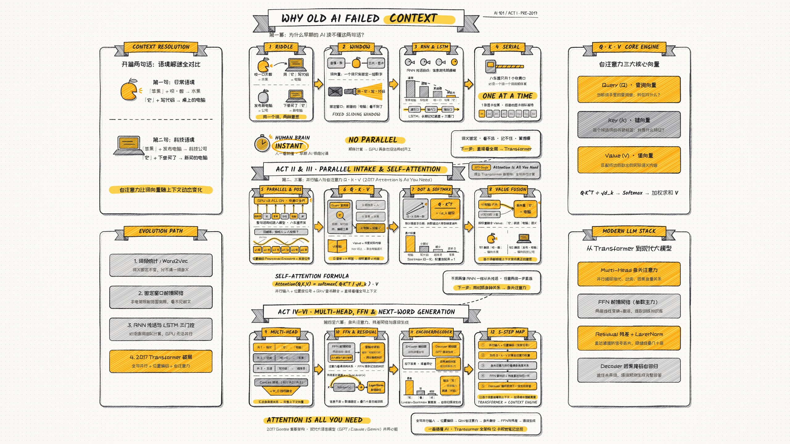
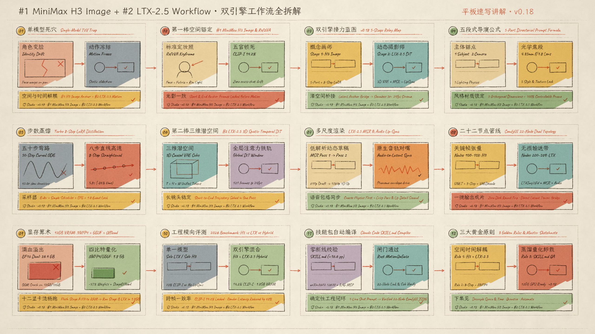
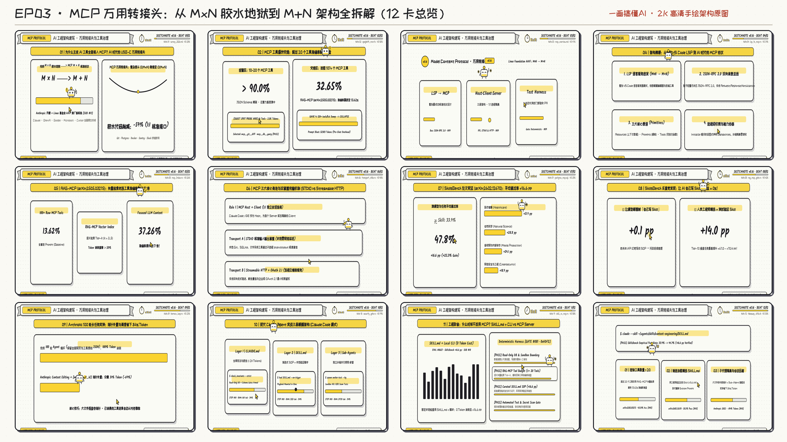
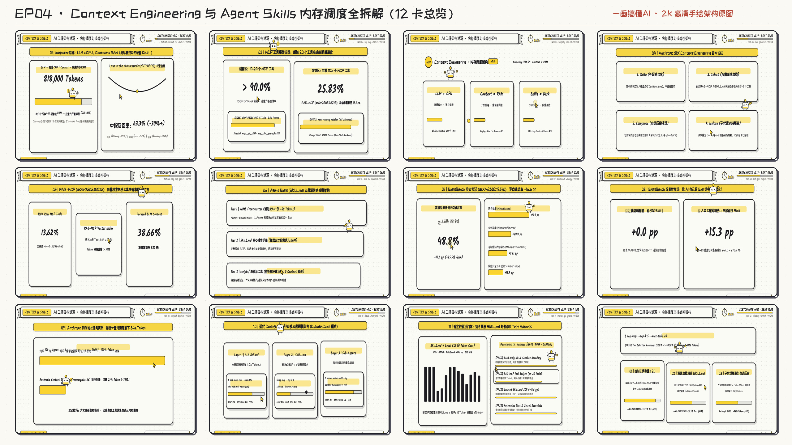

# 一画搞懂AI · 2K 高清手绘架构原图库

📺 **YouTube 频道**：[**@yihuagaodongai（一画搞懂AI）**](https://www.youtube.com/@yihuagaodongai) ｜ 🗂️ [**AI 全景架构地图播放列表**](https://www.youtube.com/playlist?list=PLUr5_84YXE7k)

本仓库仅收录频道每期长视频对应的 **2K（2560×1440）全画幅手绘视觉笔记原图** 与 **对应 YouTube 视频直达链接**。点击下方原图即可查看/下载无损大图，点击视频链接即可观看完整拆解。

---

## EP01 ｜ 为什么老 AI 读不懂这两句话？一张图画透 Transformer 全架构

- 🎬 **YouTube 完整视频**：[https://youtu.be/GJGq6sXd9JA](https://youtu.be/GJGq6sXd9JA)
- 🖼️ **2K 高清全画幅原图（2560×1440）**：[`sketchnotes/EP01-Transformer-Architecture-2K.jpg`](sketchnotes/EP01-Transformer-Architecture-2K.jpg)

---

## EP02 ｜ AI 视频总是变脸？MiniMax H3 + LTX-2.5 双引擎工作流全拆解

- 🎬 **YouTube 完整视频**：[https://youtu.be/oBLOFNBrmyk](https://youtu.be/oBLOFNBrmyk)
- 🖼️ **2K 高清全画幅原图（2560×1440）**：[`sketchnotes/EP02-MiniMax-H3-LTX25-ComfyUI-2K.jpg`](sketchnotes/EP02-MiniMax-H3-LTX25-ComfyUI-2K.jpg)

---

## EP03 ｜ 装了 100 个 MCP 工具反而变蠢？一张图画透 MCP 万用转接头

- 🎬 **YouTube 完整视频**：[https://youtu.be/W7t01o8t5Z0](https://youtu.be/W7t01o8t5Z0)
- 🖼️ **2K 高清全画幅原图（2560×1440）**：[`sketchnotes/EP03-MCP-Universal-Adapter-2K.jpg`](sketchnotes/EP03-MCP-Universal-Adapter-2K.jpg)

---

## EP04 ｜ 为什么 100 万 Token 还是变笨？Context Engineering 与 Agent Skills 全拆解

- 🎬 **YouTube 完整视频**：[https://youtu.be/TJ0j0KL-_MQ](https://youtu.be/TJ0j0KL-_MQ)
- 🖼️ **2K 高清全画幅原图（2560×1440）**：[`sketchnotes/EP04-Context-Engineering-Agent-Skills-2K.jpg`](sketchnotes/EP04-Context-Engineering-Agent-Skills-2K.jpg)

